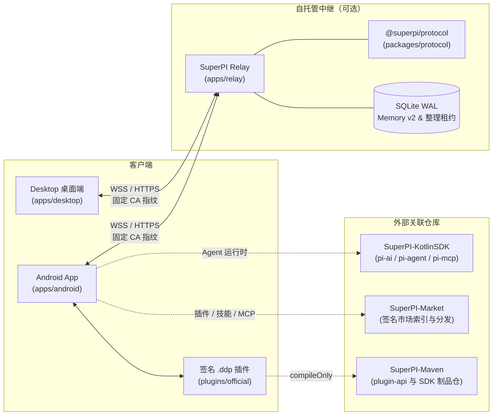

<div align="center">


# SuperPI

**个人 AI 智能体生态 —— Android · Desktop · 自托管中继 · 插件平台**

<sub>本地优先的多端个人助手：手机随叫随做、桌面无缝接管、可选自建中继同步记忆，以及可扩展的 `.ddp` 插件体系。</sub>

[English](README.md) · 简体中文

<a href="https://github.com/Sadami3066/SuperPI/releases/latest"></a>


<a href="https://github.com/Sadami3066/SuperPI/actions/workflows/ci-android.yml"></a>
<a href="https://github.com/Sadami3066/SuperPI/actions/workflows/ci-ts.yml"></a>
<a href="https://github.com/Sadami3066/SuperPI/actions/workflows/ci-plugins.yml"></a>


</div>

[整体架构](#整体架构) · [模块与生态](#模块与生态) · [快速上手](#快速上手) · [本地开发](#本地开发) · [文档导航](#文档导航) · [参与贡献](#参与贡献)

---

## 概览

**SuperPI** 是一套面向个人使用的本地优先智能体生态：

- **Android 客户端（`apps/android`）**：基于 Jetpack Compose 的手机端智能体。长按电源键语音/文字唤醒，内置 Alpine/proot（或 Root）Linux 环境，支持无线 ADB / 虚拟屏幕操作其他 App、随手生成小程序，以及安装签名 `.ddp` 插件。
- **Desktop 桌面端（`apps/desktop`）**：基于 Electron + React，通过 JSONL RPC 驱动官方 [pi](https://pi.dev) 命令行代理，与手机端共用同一个中继、远程调用彼此的 Bot 并同步共享记忆。
- **自托管中继（`apps/relay` + `packages/protocol`）**：轻量 Node.js 24 HTTPS/WSS 服务，负责设备注册配对（CA 指纹固定）、在线状态、跨设备 Bot 路由、工作区文件传输与 **Memory v2** 增量记忆同步。
- **插件体系（`plugins/`）**：包含 10 个官方插件（飞书、企业微信、小米云服务、IMAP/SMTP 邮箱、高德地图、12306、酒店、打车、主题包、MCP UI 示例）、独立第三方插件模板以及端到端回归测试夹具。

所有对话、模型密钥与会话文件默认保存在你的设备本地，不经过中心化服务器，仅与你配置的模型服务商或自托管中继通信。

## 整体架构



## 模块与生态

### 本仓库内（Monorepo）

| 目录 | 技术栈 | 职责 |
|---|---|---|
| [`apps/android/`](apps/android/) | Kotlin · Compose · Gradle | Android 宿主客户端、运行时、proot/ADB/Root 桥接、`:design` 与 `:plugin-api` |
| [`apps/desktop/`](apps/desktop/) | Electron · React · Vite | 基于 `pi --mode rpc` 的桌面端、远程 Bot 主被叫、Memory v2 客户端 |
| [`apps/relay/`](apps/relay/) | Node 24 · TypeScript · SQLite | 自托管多端中继、配对鉴权、在线态、Memory v2 增量同步与 Dream 互斥租约 |
| [`packages/protocol/`](packages/protocol/) | TypeScript · JSON Vectors | 跨端共享的线协议与 Memory v2 数据契约（含测试向量） |
| [`plugins/official/`](plugins/official/) | Kotlin · `.ddp` | 官方外部插件集合（`feishu`、`wecom`、`micloud`、`mail`、`amap`、`rail`、`hotel`、`ride`、`themes`、`mcpui-demo`） |
| [`plugins/template/`](plugins/template/) | Kotlin · Gradle | 面向社区开发者的独立 `.ddp` 插件起步模板 |
| [`plugins/sample/`](plugins/sample/) | Kotlin · Gradle | 宿主 E2E 与二进制兼容回归测试夹具 |

### 外部生态仓库

| 仓库 | 定位 | 链接 |
|---|---|---|
| **SuperPI-KotlinSDK** | 独立可复用的 KMP（`Android` + `JVM`）Agent SDK（`pi-ai`、`pi-agent`、`pi-mcp`、`pi-coding-agent`） | [Sadami3066/SuperPI-KotlinSDK](https://github.com/Sadami3066/SuperPI-KotlinSDK) |
| **SuperPI-Market** | 经 ECDSA 签名的官方插件、技能与远程 MCP 市场索引与制品托管 | [Sadami3066/SuperPI-Market](https://github.com/Sadami3066/SuperPI-Market) |
| **SuperPI-Maven** | 静态 GitHub Pages Maven 仓库，托管 SDK、`plugin-api` 与 `design` 依赖 | [Sadami3066/SuperPI-Maven](https://github.com/Sadami3066/SuperPI-Maven) |

## 快速上手

### 1. 安装 Android 客户端

1. 从 [GitHub Releases](https://github.com/Sadami3066/SuperPI/releases/latest) 下载最新的 `PI-X.Y.Z.apk`（要求 Android 10+）。
2. 按首次引导配置模型服务商（支持 42 家内置 Provider 或自定义端点），并在「设置 → 系统访问」初始化内置 Alpine Linux 环境。
3. 如需让助手控制手机屏幕，可在「设置 → 系统访问」启用无线调试或 Root。

详细使用说明见 [用户起步指南](docs/user/getting-started.md)。

### 2. 自部署多端中继（`apps/relay`）

支持 Docker 一键启动或 Node.js ≥ 24 本地运行：

```bash
# 使用 GitHub Container Registry 自动构建的镜像
docker run -d --name superpi-relay \
  -p 8443:8443 -v superpi-relay-data:/data \
  ghcr.io/sadami3066/superpi-relay:latest

# 或从源码启动（自动签发局域网 TLS 证书并输出扫码配对链接）
pnpm install
./apps/relay/scripts/dev-relay.sh
```

完整证书配置与配对流程见 [中继部署指南](docs/user/self-hosting-relay.md)。

### 3. 启动桌面端（`apps/desktop`）

前置依赖：Node.js ≥ 24、`pnpm` 以及在 `PATH` 中安装好的 `pi`（`@earendil-works/pi-coding-agent`）：

```bash
pnpm install
pnpm build:desktop
pnpm dev:desktop
```

## 本地开发

```bash
# TypeScript 全栈（Protocol + Relay + Desktop）
pnpm typecheck
pnpm test
pnpm build:desktop

# Android 宿主与插件 SDK ABI 基线检查（JDK 17 + Android SDK 36）
./apps/android/scripts/dev-setup.sh
./apps/android/scripts/check.sh --full
./apps/android/scripts/build.sh stop

# 官方插件与示例夹具构建验签
(cd plugins/official && ./scripts/check.sh)
(cd plugins/sample && ./gradlew verifyPlugin --no-daemon)

# 一键串行运行全仓库校验
./scripts/check-all.sh
```

如需在本地直接联调同级目录 `../SuperPI-KotlinSDK` 的未发布源码，可传 `-Psuperpi.localSdk=true` 或设置 `SUPERPI_LOCAL_SDK=1`。

多端发版 Tag 约定（`vX.Y.Z`、`desktop-v*`、`relay-v*`、`plugin-api-v*`、`plugin-*-v*`）请见 [发布工程文档](docs/contributing/release.md)。

## 文档导航

- **终端用户**：[文档总目录](docs/README.md) · [用户起步指南](docs/user/getting-started.md) · [中继部署指南](docs/user/self-hosting-relay.md)
- **插件开发者**：[插件生态总览](docs/plugins/README.md) · [快速上手](docs/plugins/quickstart.md) · [清单与 `.ddp` 打包](docs/plugins/manifest-and-packaging.md) · [运行时 API](docs/plugins/runtime-api.md) · [UI 扩展与设计系统](docs/plugins/ui-extensions.md) · [市场上架政策](docs/plugins/market-policy.md)
- **贡献者与维护者**：[整体架构](docs/contributing/architecture.md) · [开发指南](docs/contributing/development.md) · [发布工程](docs/contributing/release.md) · [更新记录](CHANGELOG.md)

## 参与贡献与安全反馈

欢迎提 Issue 与 Pull Request，提交前请先阅读 [CONTRIBUTING.md](CONTRIBUTING.md)。发现安全隐患请勿公开暴露，请按 [SECURITY.md](SECURITY.md) 私下联系维护者。

## 许可证

本仓库自有源码采用 [Apache-2.0](LICENSE) 开源；内置第三方组件、Linux 二进制、字体与图标归属见 [THIRD_PARTY_NOTICES.md](THIRD_PARTY_NOTICES.md)。
