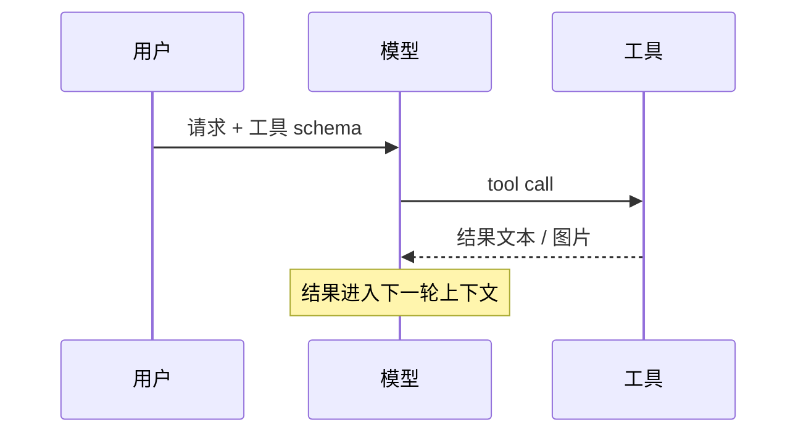

# 02 · 工具：文件 / Shell / 交付

[← 返回地图](README.md)

> **体系**：工具 schema + 工具结果  
> **进入时机**：工具定义随每次模型请求进入；工具结果进入下一轮  
> **修改入口**：SDK `tools/*`、`SuperPIBashTool.kt`、`PresentTool.kt`、`AskUserQuestionTool.kt`、`WorkspacePaths.kt`



## 30 秒版

| 关注点 | 规则 |
|---|---|
| 工具 schema | `description` + 参数 `description` 进入模型工具定义 |
| 系统提示词 | `promptSnippet` 进 `tools`；`promptGuidelines` 进 `rules` |
| 工具结果 | 文本原样进下一轮；图片走 attachment；细节不进模型文本 |
| 文件路径 | 所有文件工具要求显式绝对路径 |

## 本文件工具

| 工具 | 用途 | 定义位置 |
|---|---|---|
| `read` | 读文件/图片 | `ReadTool.kt:46` |
| `bash` | 宿主 Linux shell | `SuperPIBashTool.kt:45` |
| `edit` | 精确文本替换 | `EditTool.kt:49` |
| `write` | 新建/覆盖文件 | `WriteTool.kt:27` |
| `system_shell` | Android system shell | `SystemShellTool.kt:33` |
| `present` | 交付文件/图片/页面/小程序/卡片 | `PresentTool.kt:107` |
| `ask_user_question` | 结构化提问 | `AskUserQuestionTool.kt:79` |

## 通用规则

- `description` 进入工具 schema；`promptSnippet` 进入系统提示词 `tools`；`promptGuidelines` 进入 `rules`。
- 工具结果文本原样进入下一轮；`structuredContent` 只进 `details.deepdeep`，不改模型文本。
- 文件工具参数统一追加绝对路径规则：`File tool arguments need explicit absolute paths; the workspace is only a suggested location, not an access boundary.`

## 文件与 Shell

### `read`

- 位置：`SuperPI-KotlinSDK/.../tools/ReadTool.kt:46`
- description：

```text
Read the contents of a file. Supports text files and images (jpg, png, gif, webp, bmp). Images are sent as attachments. For text files, output is truncated to 2000 lines or 50KB (whichever is hit first). Use offset/limit for large files. When you need the full file, continue with offset until complete.
```

- snippet：`Read file contents`
- guideline：`Use read to examine files instead of cat or sed.`
- 宿主包装追加：`File tool arguments need explicit absolute paths; the workspace is only a suggested location, not an access boundary.`（`WorkspacePaths.kt:18`）

### `bash`

- 位置：`apps/android/runtime/src/main/kotlin/io/github/whywood/superpi/runtime/SuperPIBashTool.kt:45`
- 这是宿主对 SDK bash 的替换；SDK 原版 `BashTool.kt:46` 当前不生效。
- description：

```text
Execute a command in the Linux shell for the current working directory. Returns merged stdout and stderr, ending with the exit code as [exit: N]. The active shell mode, user, and path layout are described in the system prompt environment section. Output is truncated to the last 2000 lines or 50KB (whichever is hit first). Oversized output is saved to a complete log when available. Cancellation stops execution and is not retried. Optionally provide a timeout in seconds.
```

- guidelines：

```text
Check the [exit: N] marker on every bash result; investigate failures before moving on.
bash runs the session Linux shell; read the system prompt environment section for its current mode and path layout.
```

### `edit`

- 位置：`SuperPI-KotlinSDK/.../tools/EditTool.kt:49`
- description：

```text
Edit a single file using exact text replacement. Every edits[].oldText must match a unique, non-overlapping region of the original file. If two changes affect the same block or nearby lines, merge them into one edit instead of emitting overlapping edits. Do not include large unchanged regions just to connect distant changes.
```

- snippet：`Make precise file edits with exact text replacement, including multiple disjoint edits in one call`
- guidelines：

```text
Use edit for precise changes (edits[].oldText must match exactly)
When changing multiple separate locations in one file, use one edit call with multiple entries in edits[] instead of multiple edit calls
Each edits[].oldText is matched against the original file, not after earlier edits are applied. Do not emit overlapping or nested edits. Merge nearby changes into one edit.
Keep edits[].oldText as small as possible while still being unique in the file. Do not pad with large unchanged regions.
```

### `write`

- 位置：`SuperPI-KotlinSDK/.../tools/WriteTool.kt:27`
- description：

```text
Write content to a file. Creates the file if it doesn't exist, overwrites if it does. Automatically creates parent directories.
```

- snippet：`Create or overwrite files`
- guideline：`Use write only for new files or complete rewrites.`

### `system_shell`

- 位置：`apps/android/runtime/src/main/kotlin/io/github/whywood/superpi/runtime/SystemShellTool.kt:33`
- description：

```text
Run a command in the Android system shell and return the exit code with merged stdout and stderr. Use it for Android system operations such as pm, cmd, settings, dumpsys, am and getprop; use bash for ordinary Linux work. The tool fails while the active access tier has no system shell (local access).
```

- guideline：

```text
System shell output may already be truncated upstream; never claim a complete log when none is available.
```

### `ls` / `grep` / `find`

- 位置：`SuperPI-KotlinSDK/.../tools/LsTool.kt:27`、`GrepTool.kt:63`、`FindTool.kt:36`
- **当前未生效**：`PiSessionEngine.buildTools` 显式跳过 `"ls", "grep", "find"`（`PiSessionEngine.kt:288`）。

## 交付与提问

### `present`

- 位置：`apps/android/runtime/src/main/kotlin/io/github/whywood/superpi/runtime/PresentTool.kt:107`
- description：

```text
Deliver finished work to the user: files, images, videos, web pages, installed miniapps, or a card produced by a tool. Use type=card with the id shown in a tool result when showing that card helps the answer; skip cards that add nothing to the text.
```

- snippet：`Deliver finished work to the user: files, images, pages, miniapps, or cards from tool results`

### `ask_user_question`

- 位置：`apps/android/runtime/src/main/kotlin/io/github/whywood/superpi/runtime/AskUserQuestionTool.kt:79`
- description：

```text
Ask the user one to five structured questions and wait for answers. Use options for choices; omit options for free-form input. Append (Recommended) to a recommended label. Ask only when a real choice or missing fact blocks progress.
```

## 返回文本

### 结果文本总则

- 工具结果文本原样进入下一轮上下文；`ToolResultPostProcessor` 只把 `structuredContent` 放入 `details.deepdeep`，不改模型可见文本。
- 失败结果通过 `textResult(..., isError = true)` 进入，文本通常是异常消息；各工具自己的 `catch` 消息见对应文件。
- 图片结果作为附件内容进入，不是文本；超出内联限制时改用文本提示。

## `bash`

位置：`SuperPIBashTool.kt:80`

成功/失败输出格式：

```text
<stdout+stderr>

[Showing lines X-Y of Z]
[Full output: /path]
[exit: N]
```

具体通知原文：

```text
Showing lines $startLine-$totalLines of $totalLines
Showing lines $startLine-$totalLines of $totalLines (50KB limit)
Full output: $path
Output incomplete: upstream truncated it; no complete log is available
Command timed out; it was terminated and was not retried
Command terminated without an exit code
```

空输出为 `(no output)`。`[exit: N]` 始终在最后。

## `read` / `edit` / `write`

- `read` 文本结果：文件正文；被截断时追加：

```text
[Showing lines X-Y of Z. Use offset=N to continue.]
[Showing lines X-Y of Z (50KB limit). Use offset=N to continue.]
[N more lines in file. Use offset=N to continue.]
[Line N is <size>, exceeds 50KB limit. Use bash: sed -n 'Np' <path> | head -c 51200]
```

- `edit` 成功：`Successfully replaced N block(s) in <path>.`；失败为 `Could not edit file: ... Error code: ENOENT/EISDIR.`、`No changes made to ...` 等。
- `write` 成功：`Successfully wrote to <path>`。

## 固定错误 / 状态文本

以下不是全部异常（异常消息通常直接取 `error.message`），而是宿主自己拼的固定文本，便于定位：

| 位置 | 文本 |
|---|---|
| `SystemShellTool.kt:44` | `The system shell is not available in the current access tier. Switch to wireless debugging (ADB) or Root access to run Android system commands, or use bash for Linux work.` |
| `PresentTool.kt:117` | `Session is not bound` |
| `AskUserQuestionTool.kt:88` | `Session is not bound` |
| `AskUserQuestionTool.kt:98` | `The user cancelled the question` |
| `AskUserQuestionTool.kt:96` | `Timed out waiting for the user's answer.` |
| `GoalTools.kt:85` | `No session is bound. Goal tools require an active session.` |
| `GoalTools.kt:136` | `No goal exists for this session. Use create_goal first.` |
| `GoalTools.kt:99` | `create is only allowed when the user directly asks for a goal. Do not create goals on your own.` |
| `JobTools.kt:144` | `No session is bound` |
| `JobTools.kt:140` | `Job not found in this conversation: <id>` |
| `TimerTools.kt:118` | `Current conversation is not saved yet; cannot create a timer` |
| `TimerTools.kt:159` | `Timer not found: <id>` |
| `MemoryTools.kt:198` | `Memory recording is paused for this conversation, so nothing was saved. Let the user know they can re-enable memory recording from the top-right menu if needed.` |
| `MiniappTools.kt:181` | `miniapp not found: <app> (use miniapp_list to see installed apps)` |
| `WebTools.kt:100` | `Fetch failed: page has no readable text content` |
| `DeferredTools.kt:87` | `tool_search requires a non-empty query.` |
| `DeferredTools.kt:168` | `Unknown deferred tool: <name>. Call tool_search first.` |

---
