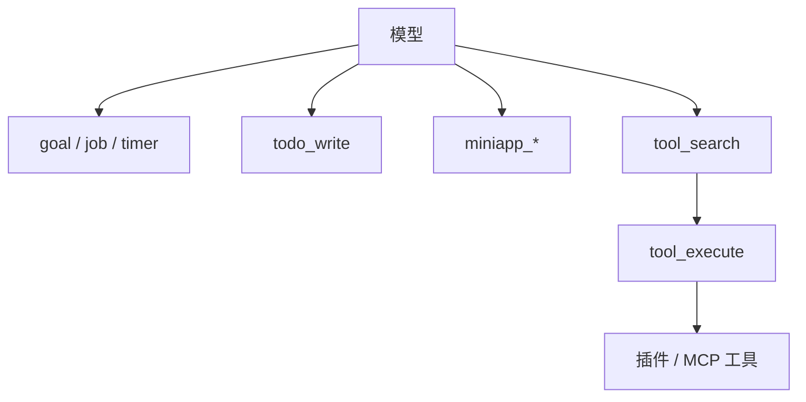

# 04 · 工具：流程 / 小程序 / 工具发现

[← 返回地图](README.md)

> **体系**：目标、后台任务、定时器、任务列表、小程序、插件/MCP 工具  
> **进入时机**：工具定义随请求进入；结果进入下一轮  
> **修改入口**：`GoalTools.kt`、`JobTools.kt`、`TimerTools.kt`、`TodoTools.kt`、`MiniappTools.kt`、`DeferredTools.kt`



## 30 秒版

| 工具组 | 关键约束 |
|---|---|
| goal | 变更要带当前 `id`/`revision`；create/edit/pause/resume 需要用户直接请求 |
| job | `job_output` 只返回上次读取后的增量；完成后会注入提醒 |
| timer | 绑定当前会话；`once` 需要日期时间，`cron` 需要五段表达式 |
| miniapp | 先写草稿目录，再 `miniapp_load`；`miniapp_edit` 只改数据层 |
| tool_search | 延迟工具先搜后调；未知名称直接失败 |

## 本文件工具

| 工具 | 用途 | 定义位置 |
|---|---|---|
| `get_goal` / `create_goal` / `update_goal` | 会话目标 | `GoalTools.kt:65` |
| `job_start` / `job_output` / `job_list` / `job_kill` | 后台 shell 任务 | `JobTools.kt:61` |
| `timer_create` / `timer_list` / `timer_update` / `timer_delete` | 定时提醒 | `TimerTools.kt:84` |
| `todo_write` | 会话任务清单 | `TodoTools.kt:58` |
| `miniapp_*` | 小程序草稿/安装/数据 | `MiniappTools.kt` |
| `tool_search` / `tool_execute` | 发现并调用延迟工具 | `DeferredTools.kt:74` |

## 目标、任务、后台

### `get_goal`

- 位置：`apps/android/runtime/src/main/kotlin/io/github/whywood/superpi/runtime/GoalTools.kt:66`
- description：

```text
Read this conversation's goal, its id, revision, state and round progress.
```

### `create_goal`

- 位置：`GoalTools.kt:67`
- description：

```text
Create and arm a concrete goal when the user requests it. Omit maxRounds for the configured default.
```

### `update_goal`

- 位置：`GoalTools.kt:68`
- description：

```text
Update the current goal using its exact id and revision from get_goal. edit/pause/resume require a user request; complete requires achieved work; blocked requires the same blocker across three goal rounds.
```

### `job_start`

- 位置：`apps/android/runtime/src/main/kotlin/io/github/whywood/superpi/runtime/JobTools.kt:62`
- description：

```text
Start a long-running shell command in this conversation and return its job id immediately.
```

### `job_output`

- 位置：`JobTools.kt:63`
- description：

```text
Read output since the previous read and the current status. wait=true waits for new output or completion; timeout leaves the job running.
```

### `job_list`

- 位置：`JobTools.kt:64`
- description：

```text
List this conversation's running and finished background jobs.
```

### `job_kill`

- 位置：`JobTools.kt:65`
- description：

```text
Request cancellation of a background job. Read job_output to confirm its final status.
```

### `timer_create`

- 位置：`apps/android/runtime/src/main/kotlin/io/github/whywood/superpi/runtime/TimerTools.kt:85`
- description：

```text
Create a timer in this conversation. once needs date/time, cron needs a five-field expression. enabled defaults to true; false creates a disabled timer.
```

### `timer_list`

- 位置：`TimerTools.kt:86`
- description：

```text
List timers in this conversation with their ids, trigger details, enabled state and delivery results.
```

### `timer_update`

- 位置：`TimerTools.kt:87`
- description：

```text
Update only supplied timer fields using an id from timer_list. The conversation cannot change.
```

### `timer_delete`

- 位置：`TimerTools.kt:88`
- description：

```text
Delete a timer by its id from timer_list.
```

### `todo_write`

- 位置：`apps/android/runtime/src/main/kotlin/io/github/whywood/superpi/runtime/TodoTools.kt:58`
- description：

```text
Update the task list for this session. Send the complete list every time; omitted items are removed.
```

- snippet：`todo_write: maintain the session task list with pending, in-progress and completed items.`
- guidelines：

```text
Use todo_write for multi-step work so the user can follow progress.
Send the complete list on every call; keep at most one item in_progress.
```

## 小程序、工具发现

### `miniapp_create`

- 位置：`apps/android/runtime/src/main/kotlin/io/github/whywood/superpi/runtime/MiniappTools.kt:72`
- description：

```text
Create a miniapp draft: a self-contained HTML/CSS/JS folder the user can open on the phone. Returns the draft folder where you write the app files; call miniapp_load afterwards to install it.
```

### `miniapp_load`

- 位置：`MiniappTools.kt:100`
- description：

```text
Install a miniapp draft so the user can open it. Call it with the absolute draft path returned by miniapp_create after writing all app files; relative paths are rejected.
```

### `miniapp_list`

- 位置：`MiniappTools.kt:130`
- description：

```text
List installed miniapps and the current drafts with their absolute folder paths.
```

### `miniapp_delete`

- 位置：`MiniappTools.kt:174`
- description：

```text
Delete an installed miniapp together with all of its saved data. Use it when the user asks to remove a mini app; this cannot be undone.
```

### `miniapp_edit`

- 位置：`MiniappTools.kt:234`
- description：

```text
Read or edit one JSON value in a miniapp's persisted data layer (not its code): action get reads a key, set writes or overwrites it, delete removes it, keys lists all keys.
```

### `tool_search`（宿主版）

- 位置：`apps/android/runtime/src/main/kotlin/io/github/whywood/superpi/runtime/DeferredTools.kt:74`
- description：

```text
Search deferred tools from MCP servers and plugins. Returns tool names and parameters; call tool_execute to run one.
```

- snippet：`Use tool_search to discover deferred MCP or plugin tools, then tool_execute to call one.`
- guidelines：

```text
Deferred tools are not callable directly; search first, then execute by name.
Do not guess deferred tool names without calling tool_search first.
```

### `tool_search`（SDK MCP 版，当前未生效）

- 位置：`SuperPI-KotlinSDK/.../mcp/McpToolSearch.kt:167`
- host 传入 `autoEnableToolSearch = false`，当前由宿主版替代。
- description：

```text
# Tool discovery

Searches over deferred tool metadata with BM25 and exposes matching tools for the next model call.

Some of the tools, such as tools of MCP servers, may not have been provided to you upfront, and you should use this tool (`tool_search`) to search for the required tools. For MCP tool discovery, always use `tool_search`.
```

### `tool_execute`

- 位置：`DeferredTools.kt:153`
- description：

```text
Execute one deferred MCP or plugin tool found with tool_search.
```

- snippet：`Run a deferred tool by name after finding it with tool_search.`
- guideline：`Unknown names fail; call tool_search before tool_execute.`

## 动态工具

### 插件工具

- 位置：`apps/android/app/src/main/kotlin/io/github/whywood/superpi/plugin/host/PluginToolAdapter.kt:22`
- 工具名、`description`、`parameters`、`promptSnippet`、`promptGuidelines` 全部由 `PluginTool` 提供，原样进入 schema / `tools` / `rules`。

### MCP 工具

- 位置：`SuperPI-KotlinSDK/.../mcp/McpToolAdapter.kt:57`
- description 取服务端 `tool.description`，为空时用 `tool.title`，再为空时用 `MCP tool <name> from server <server>`，最终截到 1,024 字符；参数 schema 来自服务端 `inputSchema`。工具名格式 `mcp__<server>__<tool>`，最长 64 字符，超长加稳定哈希后缀。
- 直接暴露的 MCP 工具进入工具列表；Deferred/Codemode 工具只在 `tool_search` 结果中出现。`mcp_servers` section 只列服务器名称和首行描述。

---

## 返回文本

## 任务、目标、定时、交付

- `job_start`：`Started background job <id>.\n\nUse job_output with jobId=<id> to read output, or job_kill to stop it.`
- `job_output`：可选 `[older output was dropped from the in-memory buffer]\n` + 输出 + `\n[status: <status>]`；状态文本为 `running` / `done exit=N` / `failed exit=N` / `killed` / `interrupted unknown`。
- `job_list`：每行 `<id> <status> — <label>`，空列表为 `no background jobs`。
- `job_kill`：`Cancellation requested.` 或 `The job has already finished.`
- `job` 完成后会话注入见 6.4。
- `todo_write`：`Updated todo list: N pending, N in progress, N completed.`
- `timer_create/update/delete`：返回 `timerJson`，包含 `id/name/trigger/nextRunAt/enabled/lastDeliveredAt/lastError`；`timer_list` 返回 `{"timers":[...]}`。
- `goal`：返回 `{"goal": {...} | null, "activation": {"armed": bool}}`；错误文本见 `GoalTools.kt`。
- `present`：返回 `{"items":[{"type":...}]}`；文件项带 `path/name/mime`，卡片项带 `id/title`。
- `miniapp_create`：返回 `{"ok":true,"draft":{"id":...,"name":...,"path":...},"next":"Write the app files under <path> with absolute paths using read/write/edit (entry defaults to index.html). Follow the miniapp skill. Then call miniapp_load with path=<path>."}`。
- `miniapp_load`：返回 `{"ok":true,"delivery":"present","app":{...},"path":...,"next":"Deliver this app with present: {items:[{type:miniapp, id:<id>}]}. Do not restate the app details in your reply."}`。
- `miniapp_delete`：`{"ok":true,"deleted":true,"app":"..."}`。
- `ask_user_question`：成功返回 `{"answers":[{"id":...,"selected":[...],"custom":...}]}`（只含已回答的问题）；超时 `Timed out waiting for the user's answer.`；取消 `The user cancelled the question`。

### 工具发现 / MCP / 插件返回

- 宿主 `tool_search`：`Matched N deferred tool(s). Call tool_execute with name and arguments.`；空结果 `No deferred tools matched: <query>`。
- `tool_execute`：未知工具 `Unknown deferred tool: <name>. Call tool_search first.`。
- MCP 工具：文本/图片按 MCP content 转换；空错误结果为 `MCP tool <server>/<tool> returned an error`。
- 插件工具：结果由插件返回，宿主不重写。
