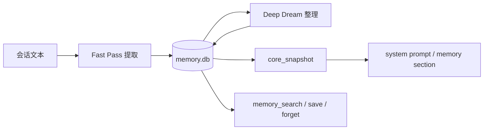

# 05 · 记忆

[← 返回地图](README.md)

> **体系**：长期记忆的写入、整理、注入与查询  
> **进入时机**：Fast Pass（会话关闭/压缩/空闲）→ 本地库；Dream 定时；快照进入系统提示词；工具按需查询  
> **修改入口**：`MemoryIngestor.kt`、`MemoryDreamer.kt`、`MemorySnapshotRenderer.kt`、`MemoryTools.kt`



## 30 秒版

| 层 | 内容 | 预算/上限 |
|---|---|---|
| Fast Pass | 提取 durable facts / plans / habits / episodes | transcript 80k 字符，最多 12 条/20 解析 |
| 核心快照 | 5 节，只放 ACTIVE | 4,500 token / 18,000 字符 |
| Deep Dream | 晋升、覆盖、过期、归档、实体合并 | core 120 / episodic 120 |
| 工具查询 | 全库 FTS + 实体 | 默认 8 条，最多 25 条 |

## 记忆工具定义

### `memory_search`

- 位置：`apps/android/runtime/src/main/kotlin/io/github/whywood/superpi/runtime/memory/MemoryTools.kt:139`
- description：

```text
Search long-term personal memory across profile traits, active plans, collaboration habits, events, and entity aliases.
```

- snippet：`Search personal memory before answering past-context questions`
- guidelines：

```text
Use stored memory silently to align tone, choices, and defaults; do not show off or say 'as you told me last Tuesday' unnecessarily.
Only bring up active follow-ups in conversation when the user brings up a fitting context; never invent proactive notifications.
Search memory with 2-4 synonymous or entity keywords before guessing past facts; set includeHistory=true when asking about earlier or changed states.
If memory_search finds nothing relevant, say so honestly instead of fabricating a memory.
```

### `memory_save`

- 位置：`MemoryTools.kt:183`
- description：

```text
Save or update an explicit durable personal memory entry.
```

- snippet：`Save explicit user preferences, facts, plans, or updates`
- guidelines：

```text
When the user explicitly asks to remember or update something, call memory_save immediately.
When replacing a changed fact (like moving cities or changing preferences), search first and pass supersedesId so old state is marked superseded cleanly.
Only pass durable personal understanding, active commitments, or reusable habits; leave out casual banter, sarcasm, and secrets.
```

### `memory_forget`

- 位置：`MemoryTools.kt:251`
- description：

```text
Delete a specific memory by id, forget a topic tag, or remove closely matching memories when asked to forget.
```

- snippet：`Forget requested memories cleanly`
- guideline：`When the user asks you to forget something or stop assuming a preference, call memory_forget immediately.`

### `memory_overview`

- 位置：`MemoryTools.kt:309`
- description：

```text
Show a summary of stored personal memory counts and top topics.
```

- snippet：`Inspect personal memory summary`

## 记忆工具返回

`memory_search` 命中格式（`MemoryTools.kt:336`）：

```text
1. [id=<id>] [<kind>]<stateLabel> (<date>, <confidence>, score=<0.00>)
   <content> tags=[...] entities=[...]
```

`stateLabel` 取 ` [SUPERSEDED by ...]`、` [EXPIRED]`、` [ARCHIVED]` 或空。

其余固定文本：

```text
No matching personal memories found.
Saved (KIND, id=...): <content>
Forgot memory <id>.
Memory <id> was not found.
Forgot N memory item(s) under tag #<tag>.
No matching memory found for "<query>".
Forgot 1 memory item:
- <content>
Multiple or low-confidence memories matched "<query>". Call memory_forget with the exact id(s) to remove:
- [<id>] <content>
Provide id, tag, or query to forget.
Nothing saved: content cannot be empty.
Memory recording is paused for this conversation, so nothing was saved. Let the user know they can re-enable memory recording from the top-right menu if needed.
```

`memory_overview` 输出：

```text
Active memories: N
- About me: N
- Active & follow-ups: N
- Collaboration habits: N
- Episodes & diary: N
Tracked entities: N
Top tags: #tag(n), ...
```

## Fast Pass 提取 prompt

位置：`apps/android/runtime/src/main/kotlin/io/github/whywood/superpi/runtime/memory/MemoryIngestor.kt:519`

```text
You extract structured personal memory candidates from a user-assistant conversation.
Today's date: <yyyy-MM-dd>

Rules:
1. Extract ONLY durable personal facts, active near-term commitments/plans, reusable collaboration habits, or noteworthy dated episodes.
2. Ignore casual banter, greetings, sarcasm, jokes, hypothetical 'what-if' coding/writing examples, temporary debugging logs, and secrets/passwords/tokens.
3. Write `content` cleanly in the user's primary language, keeping exact proper nouns, product names, and people names untouched.
4. Every item MUST include a short verbatim `quote` grounded in what the user said or directly agreed to.
5. If an item directly replaces/updates an existing memory in the list below, set `action` = "UPDATE" and `supersedes_id` to that exact existing ID. Otherwise use `action` = "ADD".
6. Set `confidence` = "OBSERVED" for explicitly stated facts, or "INFERRED" for reasonable deductions.
7. For `ACTIVE` items with a clear timeframe, set integer `valid_until_days` (e.g. 7 or 14); otherwise null.
8. Merge closely related fragments on the same topic into one clear entry and return at most 12 high-value items per pass.
9. Output ONLY valid JSON matching: {"items":[{"action":"ADD|UPDATE","supersedes_id":null,"kind":"IDENTITY|ACTIVE|HABIT|EPISODIC","content":"...","tags":["..."],"entities":[{"name":"...","kind":"PERSON|PROJECT|PLACE|TOPIC|OTHER"}],"confidence":"OBSERVED|INFERRED","importance":3,"valid_until_days":null,"quote":"..."}]}. Return {"items":[]} when nothing should be saved.

<existing_memories>
- [id=...] (<kind>) <content>
</existing_memories>

<known_entities>
- <canonicalName> (<kind>) aliases=...
</known_entities>

<conversation>
<transcript>
</conversation>
```

取数上限：`existingCore` 最多 50 条，`entities` 最多 40 条，transcript 最多 80,000 字符（超长保留末尾并前置 `...(truncated)`）；解析最多 20 条，prompt 要求最多 12 条；`quote` 解析截 240 字符。

transcript 只包含会话中的用户/助手文本，前缀分别为 `User: `、`Assistant: `，不含工具调用和工具结果；初始至少 4 条消息、增量至少 2 条才触发。

## Deep Dream prompt

位置：`apps/android/runtime/src/main/kotlin/io/github/whywood/superpi/runtime/memory/MemoryDreamer.kt:303`

```text
You perform periodic sleep-time consolidation for a personal AI assistant's long-term memory.
Today's date: <yyyy-MM-dd>

Goals:
1. Promote repeated patterns or enduring takeaways from recent episodes into IDENTITY, ACTIVE, or HABIT items.
2. Resolve contradictions: if a newer episode or active note invalidates an older ACTIVE/IDENTITY/HABIT entry, output a supersession (`old_id` -> new concise statement).
3. Mark completed or stale `ACTIVE` items as expired (`expirations`), and redundant low-value items as archived (`archives`).
4. Merge duplicate entities / aliases (e.g. nickname vs full name) into a clean canonical entity (`entity_merges`).

Hard Safety Rules:
- NEVER modify, supersede, expire, or archive any entry marked `[PINNED]`.
- NEVER expire or archive `[CONFIRMED]` entries unless directly superseded with a replacement.
- Keep the user's original language and exact proper nouns/names.
- Output ONLY strict JSON:
{"promotions":[{"kind":"IDENTITY|ACTIVE|HABIT","content":"...","tags":[],"entities":[],"confidence":"OBSERVED|INFERRED","importance":4,"valid_until_days":null}],"supersessions":[{"old_id":"...","kind":"IDENTITY|ACTIVE|HABIT","content":"...","tags":[],"entities":[],"confidence":"OBSERVED|INFERRED","importance":4,"valid_until_days":null}],"expirations":["id"],"archives":["id"],"entity_merges":[{"keep_name":"...","merge_names":["..."],"summary":"..."}]}

<active_core_memories>
- [id=...] [<kind>] [<confidence>] [PINNED] (<date>) <content>
</active_core_memories>

<recent_episodes>
- [id=...] (<date>) <content>
</recent_episodes>

<entities>
- <canonicalName> (<kind>) aliases=[...] summary=...
</entities>
```

取数：core 120 条、episodic 120 条（自上次 Dream 或 30 天内）、entities 全部 active；没有总字符预算。

## 核心快照

位置：`apps/android/runtime/src/main/kotlin/io/github/whywood/superpi/runtime/memory/MemorySnapshotRenderer.kt:15`

只取 ACTIVE 记录，五节；空节不输出：

```text
# About the User
- <summary 或 content>[ [inferred]][ [tags]]

# Active & Follow-ups
- <summary 或 content>[ [inferred]] (until <date>)[ [tags]]

# Collaboration Habits
- <summary 或 content>[ [inferred]][ [tags]]

# Recent Episodes
- [<yyyy-MM-dd>] <content>

# People & Topics
- <canonicalName> (aliases: ...): <summary>
```

预算：

- 总预算：4,500 估算 token / 18,000 字符；超限按 90% 逐步截断并追加 `…`。
- 分节预算：About 1,200 token、Active 1,200、Habits 800、Episodes 900、People & Topics 400。
- 每节按行加入，达到预算即停止；至少保留第一行。
- 中文 token 估算为 1.5/字，英文 0.3/字。

取数（`MemoryStore.kt:952`）：

- IDENTITY：120 条
- HABIT：100 条
- ACTIVE：120 条，渲染时过滤 `validUntil`
- EPISODIC：14 天内 80 条；渲染时只保留最近 2 天，或 14 天内 `importance >= 4`
- entities：全部 active，但只渲染被 ACTIVE 记录引用到的实体

排序：`pinned` > `confidence` > `importance` > `updatedAt`；Episodes 按日期倒序再按重要性。

## 记忆结果的其他文本

- 记忆条目 `summary` 优先于正文进入快照。
- 实体 `summary` 和 aliases 进入 People & Topics。
- 记忆工具返回见 3.4。
- `memory_overview` 的统计文本见 3.4。

---

## 快照与注入的关系

- 快照缓存位置：`core_snapshot`。
- 重建时机：保存/编辑/删除/恢复/摄入/Dream/远端同步/账号切换。
- 注入方式：`memory` section；变化时由 system prompt patch 追加。
- 旧记录、历史状态不进入快照；模型需要时用 `memory_search(includeHistory=true)`。
