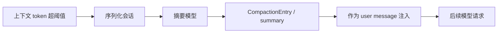

# 06 · 压缩与摘要

[← 返回地图](README.md)

> **体系**：长会话压缩、分支摘要、会话标题  
> **进入时机**：上下文超过阈值时自动压缩；手动压缩；分支回溯；首条消息生成标题  
> **修改入口**：SDK `SummaryPrompts.kt`、`Compaction.kt`、`Projection.kt`、`SessionTitleService.kt`



## 30 秒版

- 摘要 prompt 是独立的 `SUMMARIZATION_SYSTEM_PROMPT`，不复用主会话人格。
- 摘要正文格式固定：Goal / Constraints / Progress / Decisions / Next Steps / Critical Context。
- 旧摘要作为 `<previous-summary>` 输入；新消息增量更新。
- 工具结果进入摘要前截到 2,000 字符。
- 压缩摘要以 user message 形式进入上下文，不是 system message。

位置：`SuperPI-KotlinSDK/pi-coding-agent/src/commonMain/kotlin/io/github/whywood/superpi/sdk/coding/compaction/SummaryPrompts.kt`

## 摘要 system prompt

```text
You are a context summarization assistant. Your task is to read a conversation between a user and an AI assistant, then produce a structured summary following the exact format specified.

Do NOT continue the conversation. Do NOT respond to any questions in the conversation. ONLY output the structured summary.
```

## 首次压缩 user prompt

```text
The messages above are a conversation to summarize. Create a structured context checkpoint summary that another LLM will use to continue the work.

Use this EXACT format:

## Goal
[What is the user trying to accomplish? Can be multiple items if the session covers different tasks.]

## Constraints & Preferences
- [Any constraints, preferences, or requirements mentioned by user]
- [Or "(none)" if none were mentioned]

## Progress
### Done
- [x] [Completed tasks/changes]

### In Progress
- [ ] [Current work]

### Blocked
- [Issues preventing progress, if any]

## Key Decisions
- **[Decision]**: [Brief rationale]

## Next Steps
1. [Ordered list of what should happen next]

## Critical Context
- [Any data, examples, or references needed to continue]
- [Or "(none)" if not applicable]

Keep each section concise. Preserve exact file paths, function names, and error messages.
```

## 增量摘要

`UPDATE_SUMMARIZATION_INSTRUCTIONS`：

```text
Update the existing structured summary with new information. RULES:
- PRESERVE all existing information from the previous summary
- ADD new progress, decisions, and context from the new messages
- UPDATE the Progress section: move items from "In Progress" to "Done" when completed
- UPDATE "Next Steps" based on what was accomplished
- PRESERVE exact file paths, function names, and error messages
- If something is no longer relevant, you may remove it

Use this EXACT format:

## Goal
[Preserve existing goals, add new ones if the task expanded]

## Constraints & Preferences
- [Preserve existing, add new ones discovered]

## Progress
### Done
- [x] [Include previously done items AND newly completed items]

### In Progress
- [ ] [Current work - update based on progress]

### Blocked
- [Current blockers - remove if resolved]

## Key Decisions
- **[Decision]**: [Brief rationale] (preserve all previous, add new)

## Next Steps
1. [Update based on current state]

## Critical Context
- [Preserve important context, add new if needed]

Keep each section concise. Preserve exact file paths, function names, and error messages.
```

`UPDATE_SUMMARIZATION_PROMPT`：

```text
The messages above are NEW conversation messages to incorporate into the existing summary provided in <previous-summary> tags.

Update the existing structured summary with new information. RULES:
- PRESERVE all existing information from the previous summary
- ADD new progress, decisions, and context from the new messages
- UPDATE the Progress section: move items from "In Progress" to "Done" when completed
- UPDATE "Next Steps" based on what was accomplished
- PRESERVE exact file paths, function names, and error messages
- If something is no longer relevant, you may remove it

Use this EXACT format:

## Goal
[Preserve existing goals, add new ones if the task expanded]

## Constraints & Preferences
- [Preserve existing, add new ones discovered]

## Progress
### Done
- [x] [Include previously done items AND newly completed items]

### In Progress
- [ ] [Current work - update based on progress]

### Blocked
- [Current blockers - remove if resolved]

## Key Decisions
- **[Decision]**: [Brief rationale] (preserve all previous, add new)

## Next Steps
1. [Update based on current state]

## Critical Context
- [Preserve important context, add new if needed]

Keep each section concise. Preserve exact file paths, function names, and error messages.
```

## turn-prefix 摘要

```text
The messages above are earlier context from an ongoing conversation. Later messages are stored separately and do not need to be reconstructed.

Create a concise checkpoint of the user's request and the progress shown above. This checkpoint will be placed before the later messages so the conversation can continue with the necessary context.

## Original Request
[What did the user ask for?]

## Progress So Far
- [Key decisions and work completed in these messages]

## Context Needed to Continue
- [Information from these messages needed to understand the later work]

Only summarize information explicitly present above. Do not infer or recreate later messages.
```

## 分支摘要

```text
Create a structured summary of this conversation branch for context when returning later.

Use this EXACT format:

## Goal
[What was the user trying to accomplish in this branch?]

## Constraints & Preferences
- [Any constraints, preferences, or requirements mentioned]
- [Or "(none)" if none were mentioned]

## Progress
### Done
- [x] [Completed tasks/changes]

### In Progress
- [ ] [Work that was started but not finished]

### Blocked
- [Issues preventing progress, if any]

## Key Decisions
- **[Decision]**: [Brief rationale]

## Next Steps
1. [What should happen next to continue this work]

Keep each section concise. Preserve exact file paths, function names, and error messages.
```

分支摘要注入时的前缀：

```text
The following is a summary of a branch that this conversation came back from:

<summary>
...
</summary>
```

## 摘要注入格式

- 压缩摘要作为 user message 进入上下文：

```text
The conversation history before this point was compacted into the following summary:

<summary>
...
</summary>
```

- 分支摘要前缀：`The user explored a different conversation branch before returning here.\nSummary of that exploration:\n\n`
- `Projection.kt:67` 负责把 `CompactionEntry.summary` 包装成上述 user message。
- 自定义 focus：`\n\nAdditional focus: <customInstructions>` 拼接在摘要 prompt 末尾。当前宿主手动压缩没有传 custom instructions（`PiSessionEngine.kt:448`）。

## 压缩输入如何序列化

位置：`SuperPI-KotlinSDK/.../compaction/CompactionUtils.kt:103`

```text
[User]: <text>

[Assistant]: <text>

[Assistant tool calls]: <name>(<key>=<json>, ...)

[Tool result]: <text，最多 2000 字符，超出追加 "[... N more characters truncated]">
```

- `TOOL_RESULT_MAX_CHARS = 2000`。
- 会话外层：`<conversation>\n...\n</conversation>\n\n`。
- 上一份摘要外层：`<previous-summary>\n...\n</previous-summary>\n\n`。
- 文件操作附加段（如有）：`<read-files>...`、`<modified-files>...`。

## 会话标题生成

位置：`apps/android/app/src/main/kotlin/io/github/whywood/superpi/core/SessionTitleService.kt:48`

独立模型调用，不进入会话上下文：

```text
Write a short session title for the user message below, at most 6 words. Use the language the user wrote in and keep names and terms as the user wrote them. Output only the title: no quotes, punctuation or explanation.

User message:
<用户前 2000 字符>
```

---
