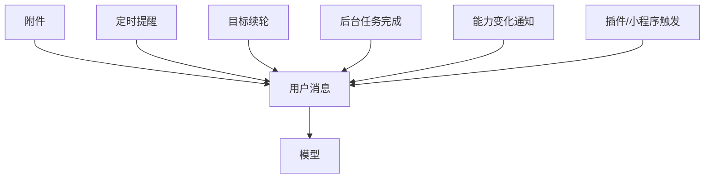

# 07 · 会话动态注入

[← 返回地图](README.md)

> **体系**：不是用户手打、但会进入会话的文本  
> **进入时机**：附件、提醒、目标续轮、后台任务完成、能力变化、插件/小程序触发  
> **修改入口**：`Attachment.kt`、`TimerService.kt`、`GoalService.kt`、`JobRegistry.kt`、`CapabilityNotices.kt`、`MiniappPluginService.kt`



## 注入一览

| 类型 | 进入形式 | 关键文本 |
|---|---|---|
| 附件 | 用户文本前置 `<attachments>` | 绝对路径 + 文件名 + MIME + 大小 |
| 定时提醒 | user message | `[Reminder] ...` |
| 目标续轮 | user message | `<goal_round>...</goal_round>` |
| 后台任务完成 | user message | `background job ... finished ...` |
| 能力变化 | user message（custom message 投影） | `Capabilities changed for this turn: ...` |
| 插件轮次 | user message | 插件传入的 `text` 原样 |
| 小程序插件任务 | 一次性 Agent prompt | `Create/Edit/Run this ...` |

## 附件块

位置：`apps/android/app/src/main/kotlin/io/github/whywood/superpi/data/Attachment.kt:87`

前置在用户文本前：

```text
<attachments>
- <absolutePath> | <name> | <mime> | <size>
- ...

use these absolute paths with file tools to inspect the attachments
</attachments>
```

## 定时提醒

位置：`apps/android/runtime/src/main/kotlin/io/github/whywood/superpi/runtime/TimerService.kt:402`

单条：

```text
[Reminder] <name>
This is a reminder you set; it is due now.

<prompt>
```

多条：

```text
[Reminder] N reminders
This is a reminder you set; it is due now.

1. <name>
<prompt>
2. <name>
<prompt>
```

作为用户消息进入会话。

## 目标续轮

位置：`apps/android/runtime/src/main/kotlin/io/github/whywood/superpi/runtime/GoalService.kt:256`

```text
<goal_round>
Objective: <objective>
Round: <round>/<maxRounds>
Continue working toward the objective. Call update_goal with action=complete when it is achieved, or action=blocked with a concrete reason when the same blocker persisted for at least 3 rounds.
</goal_round>
```

无上限时 `Round: <round>`。

## 后台任务完成

位置：`apps/android/runtime/src/main/kotlin/io/github/whywood/superpi/runtime/JobRegistry.kt:452`

```text
background job <id> (<label>) finished [status: <status>]; read its output with job_output.
```

作为用户消息进入会话。

## 能力变化通知

位置：`apps/android/runtime/src/main/kotlin/io/github/whywood/superpi/runtime/CapabilityNotices.kt:36`

```text
Capabilities changed for this turn: added tools: a, b; removed tools: c; added skills: d; removed skills: e.
```

只列变化项；每组最多 6 个，其余 `(+N more)`。通过 `appendCustomMessage(display = true)` 写入会话；SDK 将其投影为 user message，因此模型可见。

## 插件/后台轮次

- `deliverPluginTurn`：插件提供的 `text` 原样作为用户消息；`followUp` 决定排队行为，不改文本。
- `deliverBackgroundTurn`：`prompt` 原样作为用户消息；`notice` 只用于 UI 事件，不进入模型文本。
- 插件 `promptTransform` 在用户文本进入 Agent 前执行，可改写或注入文本，位置 `apps/android/runtime/src/main/kotlin/io/github/whywood/superpi/runtime/PluginRuntimeHooks.kt`。

## 其他

- 用户原文：不加工；分享/附件会前置 6.1 的块。
- 远程 Bot 的 prompt：由调用端原文传入，宿主不额外包装。
- 小程序页面请求的 `systemPrompt`：写入临时 `APPEND_SYSTEM.md`，作为 `addendum` 进入系统提示词。
- 插件通过 `MiniappPluginService` 触发的一次性 Agent 任务，固定 prompt 为：

```text
Create a mini app: <name>
<description>
<prompt>
Write the app files under the absolute path <draftDir> (entry defaults to index.html), then call miniapp_load with that absolute path.
```

```text
Edit the installed mini app <id> (directory <dir>): <instruction>
```

```text
Run this inside the mini app <id> (directory <dir>): <instruction>
```

- MCP prompt / `.pi/prompts` 模板：展开后的文本作为用户消息。
- 压缩摘要、分支摘要：见 4.6，均以 user message 进入上下文。
- 图片：作为 image content 进入，不产生文本（除非被工具以文本描述）。

<!-- APPENDIX -->
