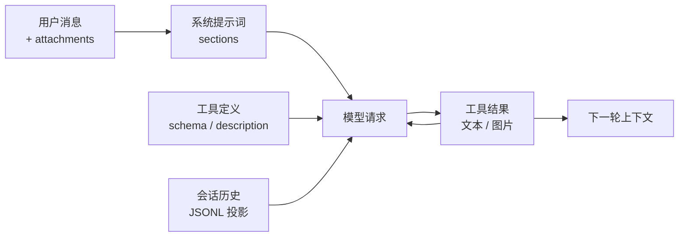
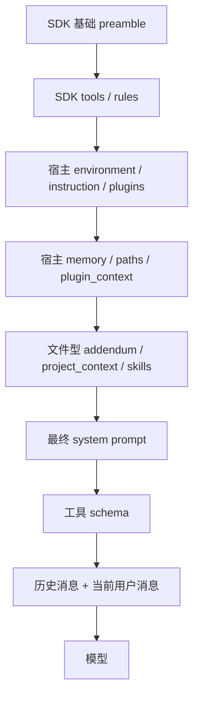

# 模型上下文提示词地图

这组文档按“体系”拆分，不再把所有文本堆在一个清单里。先看本页，再按需要进入对应文件。

## 文件导航

| 文件 | 体系 | 里面有什么 | 什么时候看 |
|---|---|---|---|
| [01-system-prompt.md](01-system-prompt.md) | 系统提示词 | SDK 基础段、宿主 section、每轮 patch、文件型提示词、插件覆盖 | 改人格、规则、环境、路径、记忆注入 |
| [02-tools-core.md](02-tools-core.md) | 工具：文件 / Shell / 交付 | `read`、`bash`、`edit`、`write`、`system_shell`、`present`、`ask_user_question`；通用工具返回规则 | 改工具描述、文件操作规范、结果格式 |
| [03-tools-device.md](03-tools-device.md) | 工具：网页 / 日历 / 屏幕 | `web_*`、`calendar`、`screen_*`、`virtual_screen` 及返回格式 | 改手机操作、网页、日程语义 |
| [04-tools-workflow.md](04-tools-workflow.md) | 工具：流程 / 小程序 / 发现 | goal、job、timer、todo、miniapp、`tool_search`、`tool_execute`、插件/MCP 工具 | 改任务、提醒、后台、小程序、工具发现 |
| [05-memory.md](05-memory.md) | 记忆 | Fast Pass、Deep Dream、核心快照、`memory_*` 工具及返回 | 改记忆提取、整理、注入语义 |
| [06-compaction.md](06-compaction.md) | 压缩与摘要 | 摘要 system prompt、增量摘要、turn-prefix、分支摘要、标题生成 | 改长会话压缩、摘要格式 |
| [07-injections.md](07-injections.md) | 会话动态注入 | 附件、提醒、目标续轮、任务完成、能力变化、插件轮次 | 改非用户手打的文本注入 |
| [08-appendix-tool-parameters.md](08-appendix-tool-parameters.md) | 附录 | 117 条单行参数 `description` 的源码位置 | 抽查工具参数文案 |

## 按改动目标找文件

| 想改什么 | 打开 |
|---|---|
| 人格、语气、规则、环境描述 | [01-system-prompt.md](01-system-prompt.md) |
| 文件/Shell/交付工具的描述与结果 | [02-tools-core.md](02-tools-core.md) |
| 网页、日历、屏幕操作语义 | [03-tools-device.md](03-tools-device.md) |
| 目标、后台任务、定时器、小程序、工具发现 | [04-tools-workflow.md](04-tools-workflow.md) |
| 记忆提取、整理、快照注入 | [05-memory.md](05-memory.md) |
| 压缩摘要、分支摘要、标题 | [06-compaction.md](06-compaction.md) |
| 附件、提醒、目标续轮、能力通知等注入 | [07-injections.md](07-injections.md) |
| 某个工具参数的说明文案 | [08-appendix-tool-parameters.md](08-appendix-tool-parameters.md) |

## 先看结论

| 层 | 当前状态 | 说明 |
|---|---|---|
| SDK 基础 preamble | 当前生效 | 宿主用 `.replace("SuperPI", "PI")` 后注入 |
| SDK `tools` / `rules` | 当前生效 | 由激活工具的 `promptSnippet` / `promptGuidelines` 生成 |
| 宿主 `environment` / `paths` / `memory` | 当前生效 | 每次请求前可重新计算；变化时以 section patch 写入 |
| `AGENTS.md` / `APPEND_SYSTEM.md` / `SKILL.md` | 当前生效 | 文件型内容，按目录规则加载 |
| 插件 `preamble` / `rules` / `sections` | 可覆盖 | 按优先级合并，有 32 KiB / 64 KiB 预算 |
| `SYSTEM.md` | 当前未生效 | 建会话时删除 `agentDir/SYSTEM.md`，且宿主 preamble 覆盖 |
| SDK `docs` section | 当前未生效 | 宿主 `docsPaths` 为空 |
| SDK `ls` / `grep` / `find` | 当前未生效 | `PiSessionEngine` 显式过滤 |
| SDK `bash` | 当前未生效 | 被宿主 `SuperPIBashTool` 替换 |
| SDK MCP `tool_search` | 当前未生效 | 宿主传入 `autoEnableToolSearch = false`，使用宿主版 |

## 一次请求的拼装顺序

1. **系统提示词**：SDK 基础段 + 宿主 section + 每轮 section patch。
2. **工具定义**：工具名、`description`、参数 JSON Schema（含参数 `description`）。
3. **历史消息**：用户/助手文本、工具调用参数、工具结果、压缩摘要、自定义消息。
4. **当前用户消息**：原文；有附件时前置 `<attachments>` 块。
5. **工具结果**：原样进入下一轮，直到模型再次请求。

系统提示词的实际拼装细看 [01-system-prompt.md](01-system-prompt.md)。

## 三个容易误判的点

- **`SYSTEM.md` 不是当前入口**：`PiSessionEngine.kt:79` 建会话时删除 `agentDir/SYSTEM.md`；项目 `.pi/SYSTEM.md` 也会被宿主默认 preamble 覆盖。
- **工具描述不等于工具定义**：`description` 在工具 schema 里；`promptSnippet` / `promptGuidelines` 才进入系统提示词的 `tools` / `rules` section。
- **不是所有工具都在**：每个 Bot 的能力开关会过滤插件、技能、MCP、屏幕、小程序工具；本文记录的是宿主注册面，最终集合还受策略影响。

## 约定

- 主仓路径以 `apps/android/`（本仓根）与同级 `../SuperPI-KotlinSDK/` 为基准。
- 行号按 2026-11-23 工作区；代码变动后以符号名为准。
- 外部插件、MCP 服务器、`AGENTS.md`、`APPEND_SYSTEM.md`、`SKILL.md` 的正文不复制，避免清单过期；只记录加载位置和注入格式。
